# One Pace Addon for Kodi

Watch the complete One Pace catalog in Kodi through your Debrid service, or over P2P.

**Requirements:** Kodi 19 (Matrix) or newer, and either a Debrid account (Real-Debrid, Premiumize, Debrid-Link, TorBox or AllDebrid) or [Elementum](#torrent-support-elementum) to play over P2P.

## What you get

- **The whole One Pace catalog:** every arc, with episode titles, plots, air dates, cast and artwork.
- **Alternative edits:** Muhn Pace (English dub for arcs One Pace hasn't dubbed), Onigashima Paced, and Shaved Egghead & Kuma Cut fill in what One Pace doesn't cover yet.
- **Debrid or P2P:** stream through your Debrid service, or leave it unconfigured and play over torrents (needs Elementum).
- **Keep episodes on your device:** download one episode or a whole season, and watch without a connection.
- **Import episodes you already have:** point it at a folder and it recognizes them. Your files are never moved, renamed or deleted.
- **Posters and thumbnails saved next to your episodes**, so your library looks right offline too.
- **Play Next:** the next episode starts on its own, and Still Watching asks before it keeps going without you.
- **Pick up where you left off:** watched marks and resume points for each episode.
- **Subtitles** in the languages you choose, saved alongside your downloads.
- **Backup and restore** your settings, watched history and resume points.

> **Note:** Muhn Pace, Onigashima Paced, and Shaved Egghead & Kuma Cut are alternative fan edits. They are not official One Pace releases and haven't gone through the same quality checks, so the One Pace team can't vouch for them.

<table>
<tr>
<td colspan="2" align="center">
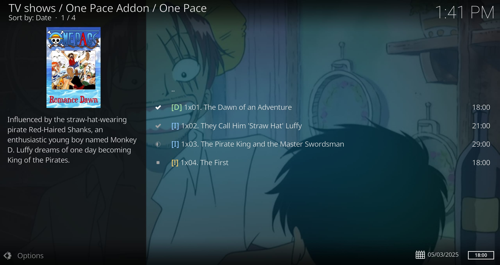<br/>
<sub><b>Your lists</b> &middot; what you have, at a glance: <b>[D]</b> downloaded, <b>[I]</b> imported, <b>[!]</b> worth fetching again.</sub>
</td>
</tr>
<tr>
<td width="50%" align="center">
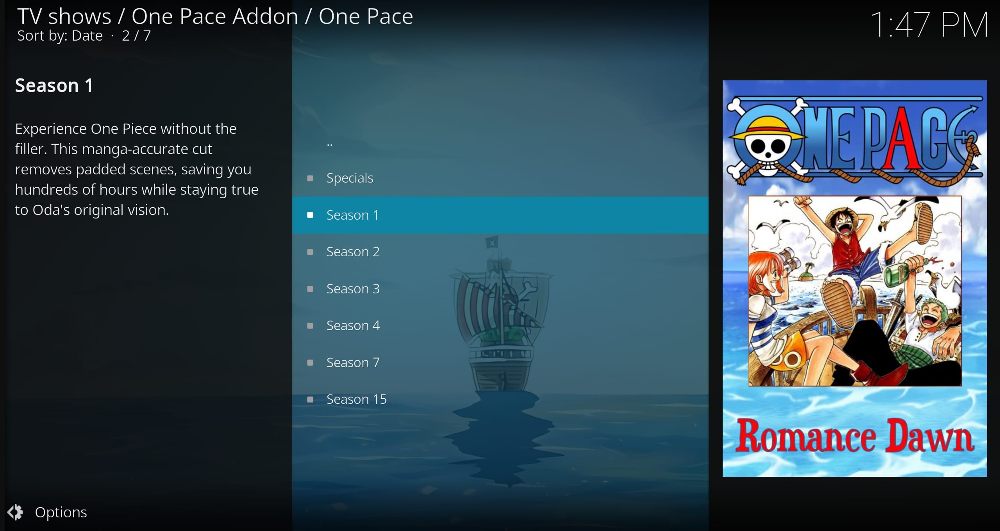<br/>
<sub><b>On Device</b> &middot; your own library, browsable and playable with no connection at all.</sub>
</td>
<td width="50%" align="center">
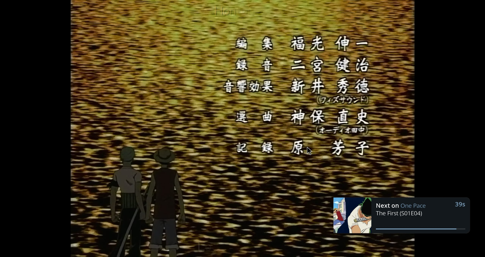<br/>
<sub><b>Play Next</b> &middot; the next episode starts on its own. Press Back to stay where you are.</sub>
</td>
</tr>
</table>

## Installation (recommended)

Using the repository means you receive automatic updates.

1. **Add source:** Go to **Settings** > **File manager** > **Add source**.
2. **Enter the URL** below and name it `One Pace Addon`.

   ```
   https://6ip.github.io/onepace-premium-kodi/
   ```

3. **Install the repository:** Go to **Add-ons** > **Install from zip file** > select `One Pace Addon` > install `repository.onepacepremium-X.Y.Z.zip`.
4. **Install the add-on:** Go to **Install from repository** > **One Pace Addon Repository** > **Video add-ons** > **One Pace Addon** > **Install**.

> If step 4 fails right after installing the repository, restart Kodi and try again.

## Step-by-step visual guide

<details>
<summary>Prefer screenshots? The full walkthrough, from adding the source to your first stream</summary>

**1.** Click the **Gear icon** in the top-left corner of the Kodi home screen.

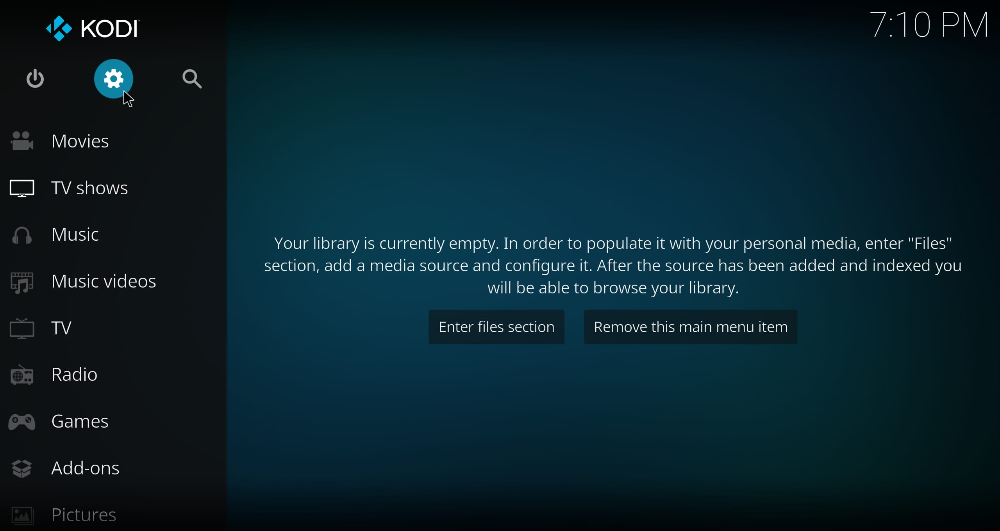

**2.** Select **File manager**.

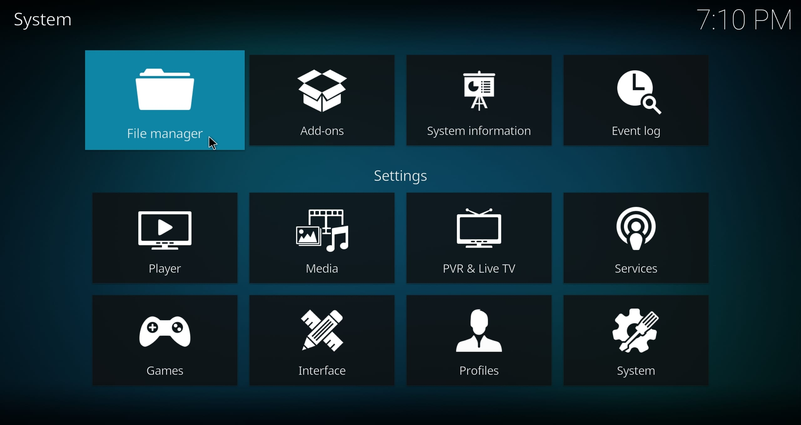

**3.** Click **Add source**.

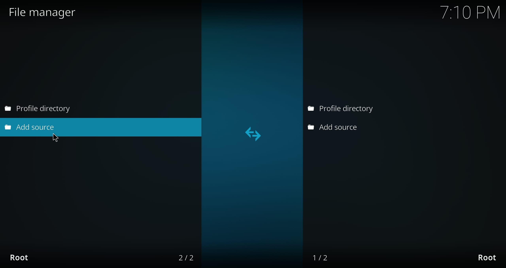

**4.** Type `https://6ip.github.io/onepace-premium-kodi/` in the top box and `One Pace Addon` in the bottom box. Press **OK** to add the source.

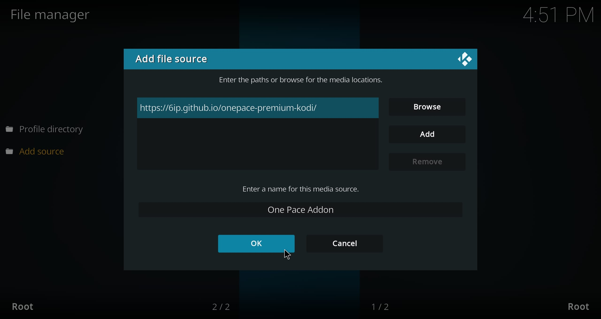

Now that the source is added, use it to install the One Pace Addon repository.

**5.** Go back to the System menu and this time select **Add-ons**.

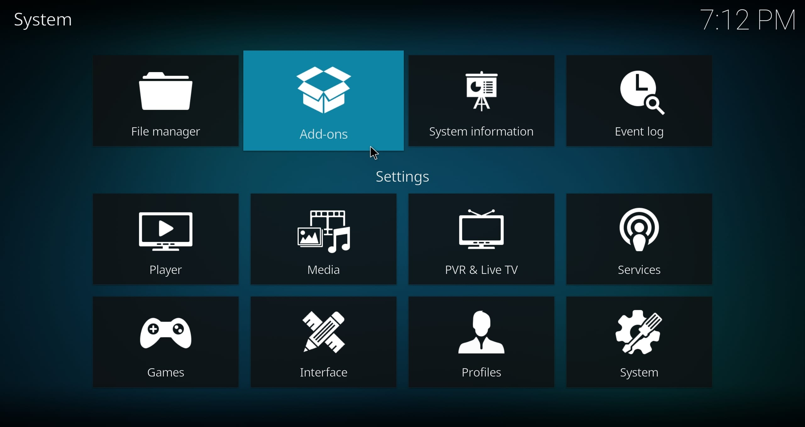

**6.** Click **Install from zip file**.

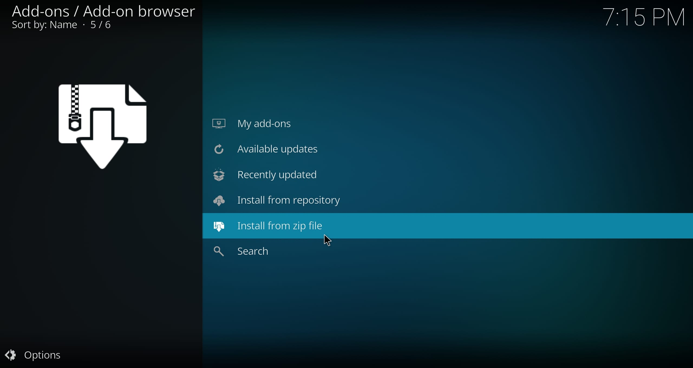

If **Unknown sources** is **enabled**, you'll see a message about the auto-update feature. Press **Yes** to continue.

If **Unknown sources** is **disabled**, you'll see a "Disabled" notification. Follow these steps:
- Press the **Settings** button on the notification.
- Enable **Show notifications** and **Unknown sources**.
- You'll see a "Warning" notification. Press **Yes**.
- Press **Back**.
- Click **Install from zip file** again.

**7.** Select **One Pace Addon**.

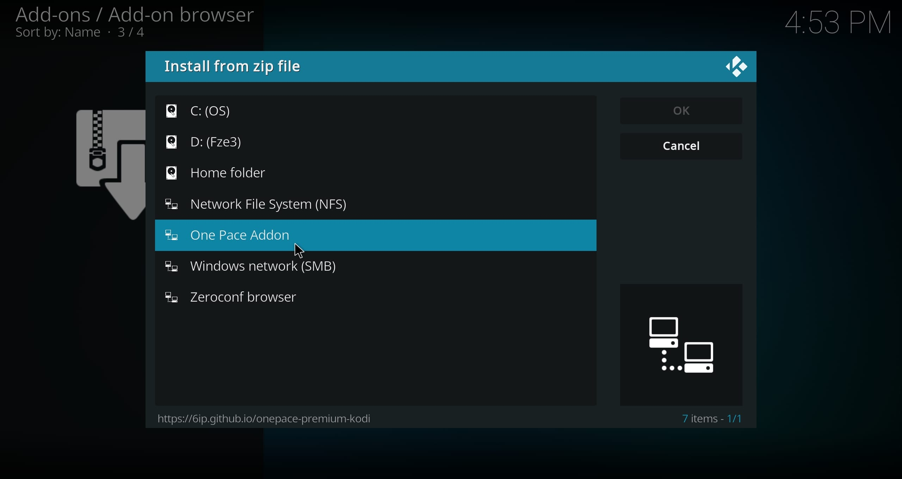

**8.** Click **repository.onepacepremium-X.Y.Z.zip** to download and install the repository.

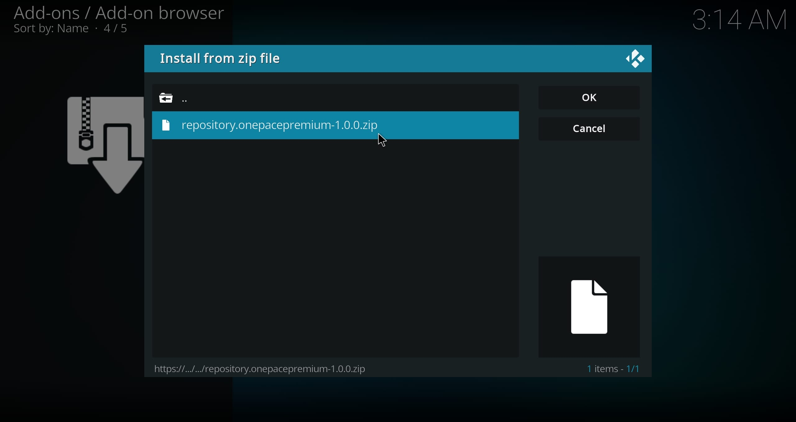

The repository is now installed. Next, use it to install the One Pace Addon add-on and its dependencies.

**9.** Select **Install from repository**.

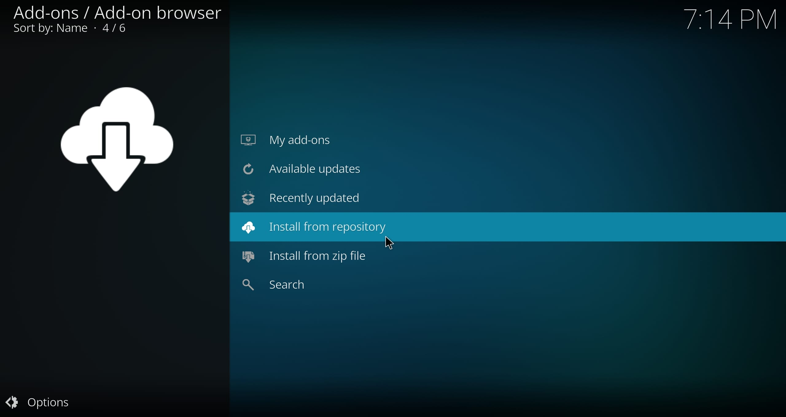

**10.** Click **One Pace Addon Repository**.

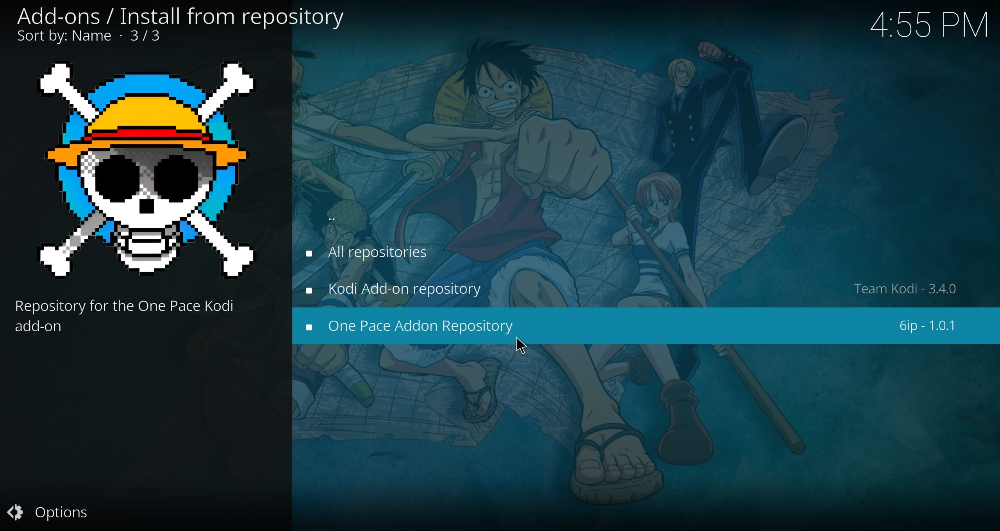

> If it fails right after installing the repository, restart Kodi and try again.

**11.** Select **Video add-ons**.

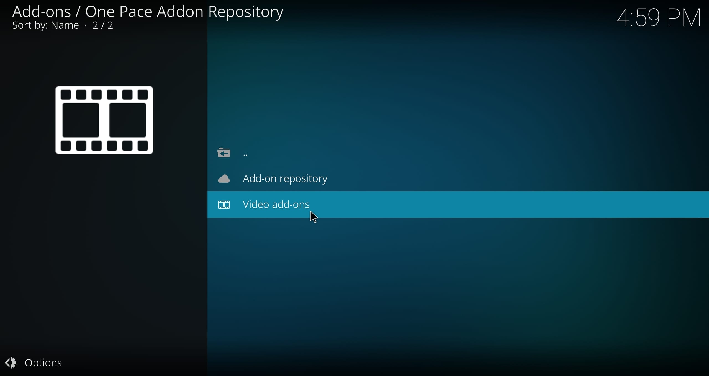

**12.** Select **One Pace Addon**.

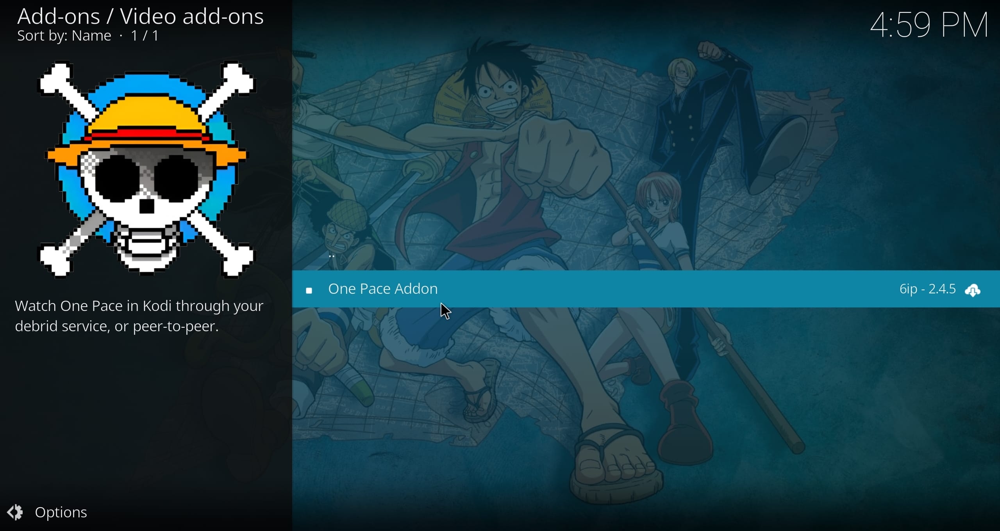

**13.** Press the **Install** button.

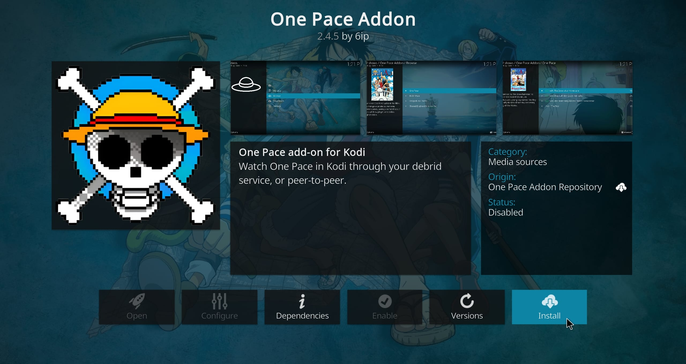

**14.** Press **OK** to install One Pace Addon and its dependencies.

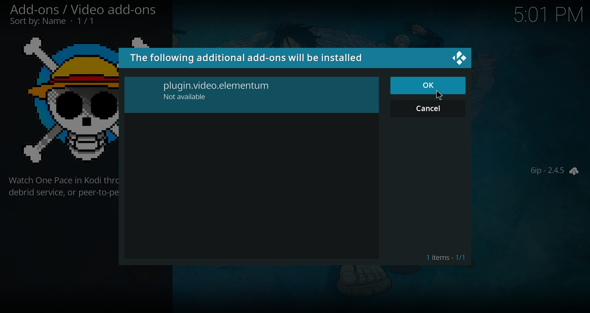

Wait a few seconds for the add-on to download. You'll see a notification when the installation is complete.

One Pace Addon is now installed on Kodi. Next, set up a Debrid account, or use P2P with Elementum (see [Torrent support](#torrent-support-elementum)), so the add-on can find video sources.

**15.** Press the **Configure** button.

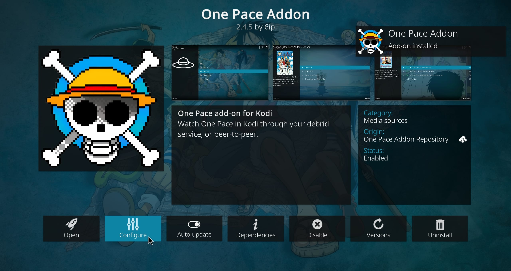

**16.** Click **Configure/Reconfigure** and follow the on-screen setup steps.

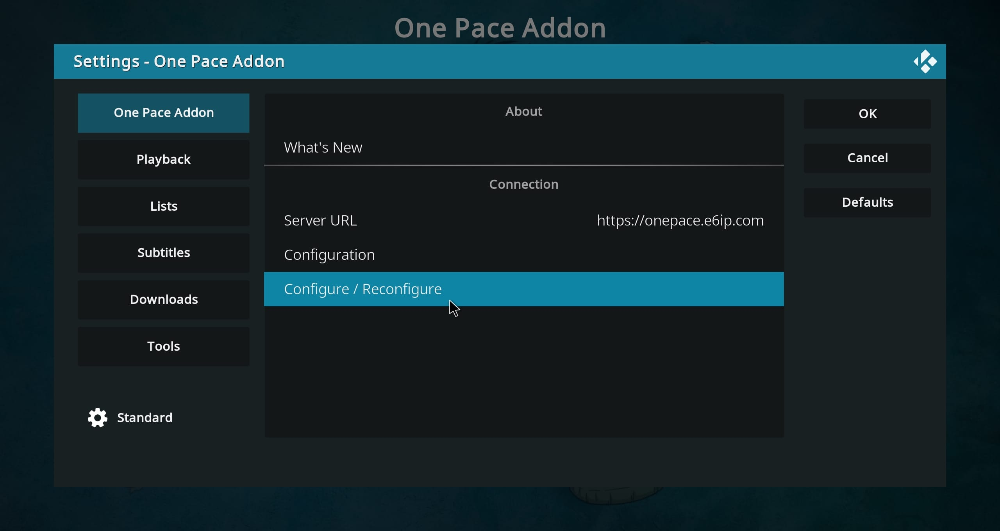

**17.** After completing the configuration, go back to Kodi and press **OK** to continue.

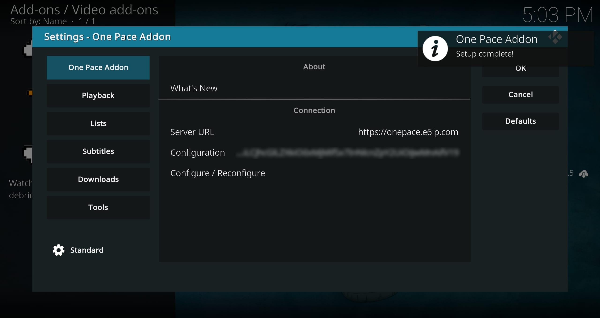

**All done!** You are ready to stream with the One Pace Addon.

</details>

## Configuration

Once installed, link the add-on to your account:

1. Go to **Add-ons** > **My add-ons** > **Video add-ons** > **One Pace Addon** > **Configure**.
2. Click **Configure/Reconfigure**.
3. An **8-character hex setup code** will appear (for example `1a2b3c4d`).
4. Open the configuration page on your phone or browser. The URL is shown on screen.
5. Add a Debrid service and paste your API key, or keep P2P.
6. Click **Install Addon**. Kodi detects the setup automatically.

> You can also open the configuration page manually, click **Setup Kodi** from the install menu, and enter the code shown in Kodi.

> If you skip the configuration, the add-on plays over P2P, which needs Elementum installed.

## Torrent support (Elementum)

Debrid streams work out of the box. Elementum is needed for P2P, including when the add-on is left unconfigured.

Elementum is an add-on that plays torrents in Kodi. Here is an [install guide](https://howtomediacenter.com/en/install-elementum-kodi/).

1. Go to **https://elementum.surge.sh/** and download the **Universal** version under *Elementum Downloads*.
2. In Kodi, go to **Add-ons** > **Install from zip file** and select the downloaded zip.
3. Elementum is now installed and ready for torrent playback.

P2P shows your IP to other peers, so a VPN is recommended.

---

## Development and building

The add-on IDs are `plugin.video.onepacepremium` and `repository.onepacepremium`. They keep the old name on purpose, so existing installs continue to receive updates.

```sh
make        # Build the add-on, the repository and the landing page
make test   # Run the test suites
make clean  # Remove build/ and dist/
```

Tests need no dependencies and can be run directly:

```sh
python tests/run.py          # everything
python tests/run.py backup   # only suites matching "backup"
```

Requires `python3` and `zip`. The GitHub Actions workflow runs `make` on every
push to `main` and deploys `dist/` to GitHub Pages.

### Build outputs (`dist/`)
```
dist/
├── index/
│   └── addons.xml + addons.xml.md5        # what the repository reads
├── addons.xml + addons.xml.md5            # kept for repositories already installed
├── repository.onepacepremium-X.Y.Z.zip   # what the page links to
├── plugin.video.onepacepremium/
│   ├── addon.xml
│   └── plugin.video.onepacepremium-X.Y.Z.zip   # what Kodi updates from
├── repository.onepacepremium/
│   ├── addon.xml
│   └── repository.onepacepremium-X.Y.Z.zip
└── index.html
```